<p align="center">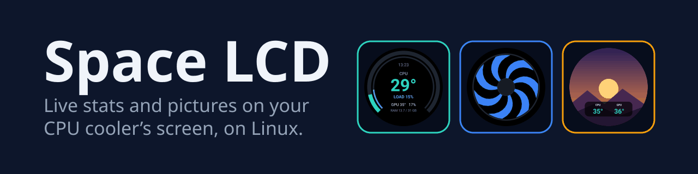</p>

<p align="center"><a href="#quick-start">Quick start</a> · <a href="#the-screens">Screens</a> · <a href="#control-panel-and-tray">Control panel</a> · <a href="docs/usage.md#smooth-video-on-the-space">Smooth video</a> · <a href="CHANGELOG.md">Changelog</a> · <a href="docs/recovery.md">Recovery</a></p>

<p align="center">
  
  
  
  
</p>

Live CPU, GPU and memory stats, clocks and animations on the round screen of your ID-COOLING SPACE LCD or NZXT Kraken 2023 cooler.

<p align="center">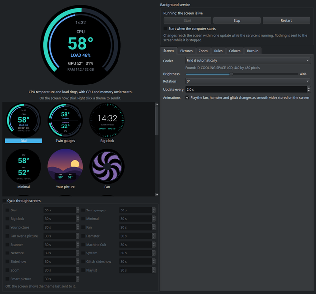</p>

## Quick start

```bash
bash install.sh
systemctl --user enable --now space-lcd
```

The installer needs no sudo and does not touch the screen. It sets up a Python
environment, the upstream driver, a settings file, a systemd user service, a **Space LCD**
menu entry and the tray icon at login. Running it again updates the install and keeps your
settings. It never starts, stops or enables the service; the second line does that, or use
the control panel.

At the end it checks that you can open the screen and prints the one command to run if
not. For the SPACE, join the `dialout` group, then log out and back in:

```bash
sudo usermod -aG dialout $USER
```

For the Kraken, add its udev rule once:

```bash
sudo bash tools/setup-kraken-udev.sh
```

Logs: `journalctl --user -u space-lcd -f`

### Try it without a cooler

From this folder, after installing, draw one frame to a file. This never opens the screen.

```bash
PYTHONPATH=src ~/.local/share/space-lcd/venv/bin/python -m space_lcd --preview /tmp/space-lcd.png --theme clock
```

## What it does

- **Eighteen screens**: stats, clocks, animations and your own pictures, each drawn for a
  round screen.
- **Control panel**: click a screen to preview it live, right click to send it to the
  cooler. Brightness, rotation, update interval, pictures and colours are all set here.
- **System tray**: a click opens the panel and another closes it.
- **Smooth animation** (SPACE): the fan, the hamster and the picture changes play as short
  videos stored on the screen itself, instead of the five or so frames a second the serial
  link can carry.
- **Smart picture**: follows the Steam game or program you are running, or the CPU
  temperature.
- **Cycle**: rotate through chosen screens, each for its own time.
- **Burn-in care**: a full screen refresh on demand or every night, and a small pixel
  shift every few minutes.
- **Background service**: a systemd user service that picks up every change within one
  update, with no restart.

## The screens

| Dial | Twin gauges | Big clock |
|---|---|---|
| 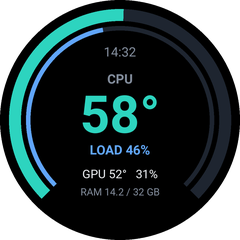 | 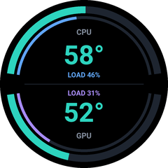 | 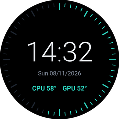 |
| **Minimal** | **Network** | **System** |
| 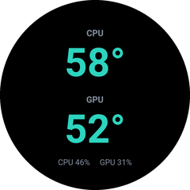 | 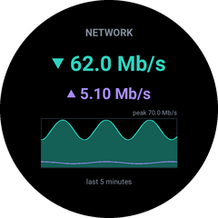 | 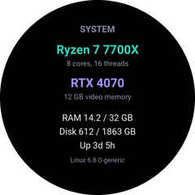 |
| **Machine Cult** | **Your picture** | |
| 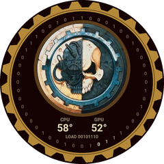 | 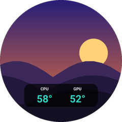 | |

| Fan (faster with load, bluer to redder with heat) | Hamster (faster with heat) | Scanner (contacts creep closer as they heat up) |
|---|---|---|
|  |  | 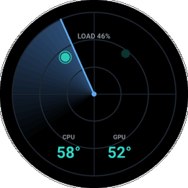 |

The rest are:

- **Fan over a picture**: the fan in front of a picture of yours, which shows through as
  the fan spins up.
- **Slideshow**: every picture in a folder in turn.
- **Glitch slideshow**: the same folder, each picture breaking up into the next.
- **Zoom**: closes in on a point you choose on each picture.
- **Playlist**: up to five pictures, each for its own time.
- **Cooler**: the cooler's own coolant, pump and fan figures, for coolers that report them
  (the Kraken; the SPACE reports none to Linux).
- **Smart picture**: chooses a picture for itself ([how](docs/usage.md#smart-picture)).

The Machine Cult is after the Warhammer 40,000 tech priests, in red and brass: their cog
skull emblem inside a ring of binary with a running cursor, the temperatures and the CPU
load in binary underneath, and a great cog round the rim that ticks round like clockwork.
If the emblem picture cannot be read it draws its own skull instead. Warhammer 40,000 and
its emblems belong to Games Workshop; this project has no connection with them. Apart from
the emblem, every picture above is made up, and every figure is a sample.

## Supported coolers

| Cooler | Screen | USB ID | Access |
|---|---|---|---|
| ID-COOLING SPACE LCD | 2.1 inch round, 480 by 480, Turing smart screen revision C | `1a86:ca21` asleep, `1d6b:0121` awake, as `/dev/ttyACM*` | the `dialout` group |
| NZXT Kraken 2023 (firmware 2.x) | 1.54 inch, 240 by 240 | `1e71:300e` | a udev rule, see [Quick start](#quick-start) |

The cooler is found by its USB ID; set `cooler` in the settings file only if you have both.
The SPACE's serial protocol comes from
[turing-smart-screen-python](https://github.com/mathoudebine/turing-smart-screen-python),
which the installer fetches at a pinned commit. The Kraken's follows
[liquidctl](https://github.com/liquidctl/liquidctl)'s firmware 2.x picture path. The Kraken
plays no stored video, so on it the animated screens are always streamed, and it shows
whole frames only.

## Control panel and tray

Open **Space LCD** from the application menu. Click a screen to preview it, then right
click it and choose **Send to device**. Every change saves at once and reaches the screen
within one update. The panel never talks to the screen itself, so it is safe to open with
the service stopped. Click the tray icon to open or close the panel.

Tabs cover the screen, [pictures](docs/usage.md#pictures), [zoom](docs/usage.md#zoom),
[Smart picture rules](docs/usage.md#smart-picture), [colours](docs/usage.md#colours) and
[burn-in](docs/usage.md#burn-in). Also in the guide: [cycling](docs/usage.md#cycling-between-screens),
[smooth video on the SPACE](docs/usage.md#smooth-video-on-the-space) and
[starting at boot](docs/usage.md#the-control-panel).

## Settings

Everything the control panel sets, plus the cooler and serial port, is in
`~/.config/space-lcd/config.ini`. [config.default.ini](config.default.ini) explains each
one. Hand edits are picked up by the running service too.

## Requirements

- Linux with systemd, Python 3 with venv, git and rsync.
- About 400 MB of disk for the Python environment, with Qt for the control panel.
- ffmpeg, for the SPACE's smooth videos. Without it the animations are streamed instead.
- `nvidia-smi` for GPU figures, which comes with the NVIDIA driver. Without it the GPU
  figures show as `--`.

## More

- [If the screen gets stuck](docs/recovery.md), which also lists every byte this program
  sends to each cooler.
- [Uninstalling](docs/uninstall-and-build.md#uninstalling),
  [building a release](docs/uninstall-and-build.md#building-a-release) and
  [the source layout](docs/uninstall-and-build.md#layout).

## Licence

The upstream SPACE driver is GPL 3.0 or later. This project imports it at run time, so
treat this project as GPL 3.0 or later too.

<!--
<summary>Space LCD README: the house header, quick start, screens, coolers and requirements.</summary>
<remarks>The longer reference sections live in docs/usage.md and docs/uninstall-and-build.md.</remarks>
-->
