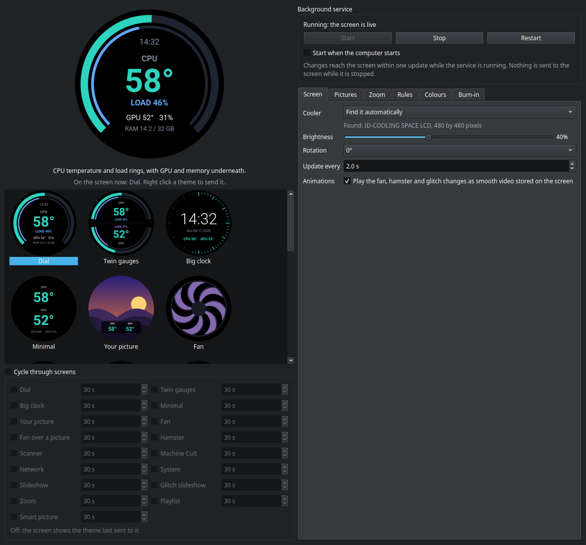
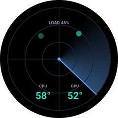

# Space LCD

Live CPU, GPU and memory stats, clocks, animations and your own pictures on the screen of
your CPU cooler, on Linux. It drives the 2.1 inch round screen of the ID-COOLING SPACE LCD,
and the 240 by 240 screen of the NZXT Kraken 2023.



## What it does

- **Eighteen screens**: stats, clocks, animations and your own pictures, each drawn for a
  round screen.
- **Control panel**: click a screen to preview it live, right click to send it to the
  cooler. Brightness, rotation, update interval, pictures and colours are all set here.
- **System tray**: a click opens the panel and another closes it; the tray starts at login.
- **Smooth animation** (SPACE): the fan, the hamster and the picture changes play as short
  videos stored on the screen itself, instead of the five or so frames a second the serial
  link can carry.
- **Smart picture**: follows the Steam game or program you are running, or the CPU
  temperature.
- **Cycle**: rotate through chosen screens, each for its own time.
- **Burn-in care**: a full screen refresh on demand or every night, and a small pixel
  shift every few minutes.
- **Background service**: a systemd user service that picks up every change within one
  update, with no restart.

## The screens

| Dial | Twin gauges | Big clock |
|---|---|---|
|  |  |  |
| **Minimal** | **Network** | **System** |
|  |  |  |
| **Machine Cult** | **Your picture** | **Scanner** |
|  |  |  |

| Fan (faster with load, bluer to redder with heat) | Hamster (faster with heat) | Scanner (contacts creep closer as they heat up) |
|---|---|---|
|  |  |  |

The rest are:

- **Fan over a picture**: the fan in front of a picture of yours, which shows through as
  the fan spins up.
- **Slideshow**: every picture in a folder in turn.
- **Glitch slideshow**: the same folder, each picture breaking up into the next.
- **Zoom**: closes in on a point you choose on each picture.
- **Playlist**: up to five pictures, each for its own time.
- **Cooler**: the cooler's own coolant, pump and fan figures, for coolers that report them
  (the Kraken; the SPACE reports none to Linux).
- **Smart picture**: chooses a picture for itself (see below).

The Machine Cult is after the Warhammer 40,000 tech priests, in red and brass: their cog
skull emblem inside a ring of binary with a running cursor, the temperatures and the CPU
load in binary underneath, and a great cog round the rim that ticks round like clockwork.
If the emblem picture cannot be read it draws its own skull instead. Warhammer 40,000 and
its emblems belong to Games Workshop; this project has no connection with them. Apart from
the emblem, every picture above is made up, and every figure is a sample.

## Supported coolers

| Cooler | Screen | USB ID | Access |
|---|---|---|---|
| ID-COOLING SPACE LCD | 2.1 inch round, 480 by 480, Turing smart screen revision C | `1a86:ca21` asleep, `1d6b:0121` awake, as `/dev/ttyACM*` | the `dialout` group |
| NZXT Kraken 2023 (firmware 2.x) | 1.54 inch, 240 by 240 | `1e71:300e` | a udev rule, see Installing |

The cooler is found by its USB ID; set `cooler` in the settings file only if you have both.
The SPACE's serial protocol comes from
[turing-smart-screen-python](https://github.com/mathoudebine/turing-smart-screen-python),
which the installer fetches at a pinned commit. The Kraken's follows
[liquidctl](https://github.com/liquidctl/liquidctl)'s firmware 2.x picture path. The Kraken
plays no stored video, so on it the animated screens are always streamed, and it shows
whole frames only.

## Requirements

- Linux with systemd, Python 3 with venv, git and rsync.
- ffmpeg, for the SPACE's smooth videos. Without it the animations are streamed instead.
- `nvidia-smi` for GPU figures, which comes with the NVIDIA driver. Without it the GPU
  figures show as `--`.

## Installing

```bash
bash install.sh
```

This needs no sudo and does not touch the screen. It sets up a Python environment (with
Qt for the control panel, about 340 MB), the upstream driver, a settings file at
`~/.config/space-lcd/config.ini`, a systemd user service, a **Space LCD** entry in the
application menu and the tray icon at login. Running it again updates the install and
keeps your settings. It never starts, stops or enables the service; do that in the control
panel, or:

```bash
systemctl --user enable --now space-lcd
```

At the end it checks that you can open the screen and prints the one command to run if
not. For the SPACE that is joining the `dialout` group, then logging out and back in:

```bash
sudo usermod -aG dialout $USER
```

For the Kraken it is a udev rule, once:

```bash
sudo bash tools/setup-kraken-udev.sh
```

Logs: `journalctl --user -u space-lcd -f`

## The control panel

Open **Space LCD** from the application menu. Click a screen to preview it; an animated one
plays in the preview, and only that one moves. Right click a screen and choose **Send to
device** to show it on the cooler (this turns the screen cycle off if it was on). Every
change saves at once and reaches the screen within one update while the service is
running, with no restart. The panel itself never talks to the screen, so it is safe to
open with the service stopped.

The panel lives in the system tray. The menu entry starts the tray icon and opens the
panel. Click the icon to open the panel, and click it again to close it; its menu has
**Open control panel**, **Close control panel** and **Quit tray icon**. Closing the panel
or quitting the tray leaves the background service as it was. To stop the tray starting
at login, remove **Space LCD tray icon** in System Settings, Autostart; installing again
will not bring it back.

**Start when the computer starts** starts the service at boot, before anyone logs in
(systemd lingering for your user, turned on by the same tick; your desktop may ask for
your password once). On the SPACE this also keeps short the time its own stock picture
shows, since that plays whenever this service is not driving the screen.

## Pictures

The **Pictures** tab sets:

- the picture for **Your picture**;
- a folder and a time for the **Slideshow** and the **Glitch slideshow**;
- up to five pictures for the **Playlist**, each for its own time (2 seconds, 2 minutes
  and so on);
- **Behind the fan**, the picture for Fan over a picture. Choosing it previews that screen
  without sending it.

Choosing any of the others switches to its screen. Each change of picture takes about a
third of a second to reach the screen.

**Picture boost**, at the top of the tab, sets brightness and contrast for every picture a
screen shows: your picture, the fan's, both slideshows, the playlist, the zoom, the Smart
picture's rules and Steam artwork. Over 100 % lifts them for a dim screen. Changing it
makes new glitch and zoom clips.

## Zoom

The **Zoom** tab holds up to five pictures. Choosing one opens it so you can click the
point to zoom into, and **Point** moves it later. Each zoom takes 3 to 20 seconds and
magnifies 2 to 12 times; the zoom feels steady because the magnification grows evenly. The
round screen starts on the middle square of each picture, and the zoom ends centred on the
point.

## Smooth video on the SPACE

The serial link carries about five frames a second. So on the SPACE, the screens that need
more play short clips stored on the screen itself, as the Windows app does with its videos.
The program only ever adds its own clips to the screen's storage and never deletes
anything there. Details and safety rules: [docs/recovery.md](docs/recovery.md).

**Fan and hamster.** The fan has nine loops, three speeds by CPU load and three colours by
temperature, about 2 MB in all; the hamster has three by temperature, under 1 MB.
`install.sh` draws them once with ffmpeg, the service uploads them once (a couple of
seconds), and they switch at most every 10 seconds. Changing the fan's colours makes a new
set, uploaded the next time the fan shows; earlier sets stay on the screen. Untick **Play
the fan and hamster as smooth video** in the Screen tab to go back to streamed frames.

**Glitch slideshow.** Each change is a 3 second clip at 24 frames a second: just over a
second of glitch, then the new picture, which then holds as a normal frame. A separate low
priority process makes the clips (400 to 500 KB for photographs), and the service uploads
each one while a picture holds. Until a change's clip is on the screen that change is
streamed, so the first round of a new folder is partly streamed. Uploads need at least 5
seconds left on a picture, so give each picture 7 seconds or more. Clips stay on the
screen, one per pair of pictures.

**Zoom.** One clip a picture (about 1 to 2 MB): the last picture fading into this one, the
zoom into its point, then a few seconds of the last frame so a late switch never shows the
zoom restarting. The clips are made in the background and uploaded together, and play from
the next change of picture. After a change on the Zoom tab or to the picture boost, the old
clips play on while new ones are made, and the new ones take over at a change of picture.
With none on the screen yet, it holds the picture still rather than stream a jerky zoom.

The Scanner, Machine Cult and Fan over a picture are always streamed, at about ten frames
a second, and store nothing on the screen.

## Smart picture

The **Smart picture** screen chooses for itself, first match wins:

1. a Steam game being played: its artwork (background and logo) from Steam's own cache on
   this PC; nothing is downloaded;
2. one of up to five programs you name in the **Rules** tab: the picture you gave it;
3. the CPU temperature band (two edges you set, three pictures);
4. otherwise a screen you choose, such as the dial.

The Rules tab says which rule applies right now. Running programs are checked once per
update; their names are only compared, never stored or logged.

## Cycling between screens

Tick **Cycle through screens**, tick the screens you want and give each a time (5 seconds
to an hour). They show in the listed order, round and round. Untick the box to go back to
the single screen picked above it. A burn-in refresh still takes over from the cycle while
it runs.

## Colours

The **Colours** tab sets every colour the screens use: background, rings, text, labels,
the cool, warm and hot temperature colours, CPU load, GPU, download, upload and the fan,
and the Machine Cult's cog, bone and eye. Pick a ready made palette (Default, Ocean,
Sunset, Neon, Mono, Amber Console, Wrist Console) or click any swatch to choose your own.
Amber Console and Wrist Console are each one colour of phosphor on a dark tube.

## Burn-in

The **Burn-in** section has two tools:

- **Clear burn-in** cycles full white, black, red, green, blue and random noise across the
  whole screen for 15 minutes to 8 hours, then returns to your screen. Run it at high
  brightness; repeated long runs (overnight) work best on stubborn retention, which usually
  fades but can be partly permanent. **Brightness during burn-in** gives the refresh its
  own brightness; your normal brightness comes back the moment it ends.
- **Move the picture slightly** (on by default) shifts everything by two pixels every few
  minutes so no edge stays on the same pixels for hours.

**Every day at** runs the same refresh at a set time for a set length, then returns the
screen to exactly what it was showing; a run can cross midnight. Stop during a scheduled
run ends tonight's run and keeps the schedule.

## Settings

Everything the control panel sets, plus the cooler and serial port, is in
`~/.config/space-lcd/config.ini`. [config.default.ini](config.default.ini) explains each
one. Hand edits are picked up by the running service too.

## Trying a screen without the cooler

From this folder, after installing:

```bash
PYTHONPATH=src ~/.local/share/space-lcd/venv/bin/python -m space_lcd --preview /tmp/space-lcd.png --theme clock
```

## If the screen gets stuck

See [docs/recovery.md](docs/recovery.md), which also lists every byte this program sends
to each cooler.

## Uninstalling

Stop the service and turn off its start at boot:

```bash
systemctl --user disable --now space-lcd
```

Then remove what `install.sh` put in place:

- `~/.local/share/space-lcd/` (the Python environment, app copy and upstream driver)
- `~/.config/space-lcd/` (your settings)
- `~/.local/state/space-lcd/` (the working folder)
- `~/.config/systemd/user/space-lcd.service`
- `~/.local/share/applications/space-lcd.desktop`
- `~/.config/autostart/space-lcd-tray.desktop`

On a Kraken, also remove `/etc/udev/rules.d/71-space-lcd-kraken.rules` (with sudo). Clips
the program stored on a SPACE stay on its storage; they are named `spacelcd_*` in
`/mnt/SDCARD/video/`.

## Building a release

```bash
./build-zip.sh
```

Runs the tests (none of which open the screen) and the house rules gate, packages the Dist
and Git zips, and updates the local App copy. Add `--no-bump` to rebuild the current
version without consuming a number.

## Layout

- `src/space_lcd/` the program: sensors, themes, the cooler drivers (`panel.py` for the
  SPACE, `kraken.py`), stored video, the service loop (`__main__.py`), the control panel
  (`ui.py`, `window.py`) and its tray icon (`tray.py`). `assets/` holds the Machine Cult's
  emblem picture.
- `tests/` unit tests; none of them open the screen.
- `service/` the systemd user unit.
- `tools/` the Kraken udev rule, the house rules check, and probe tools that refuse to run
  while the service is.
- `docs/` recovery notes, the stored video plan and the screenshots above.
- `install.sh` per user install.

## Licence

The upstream SPACE driver is GPL 3.0 or later. This project imports it at run time, so
treat this project as GPL 3.0 or later too.
